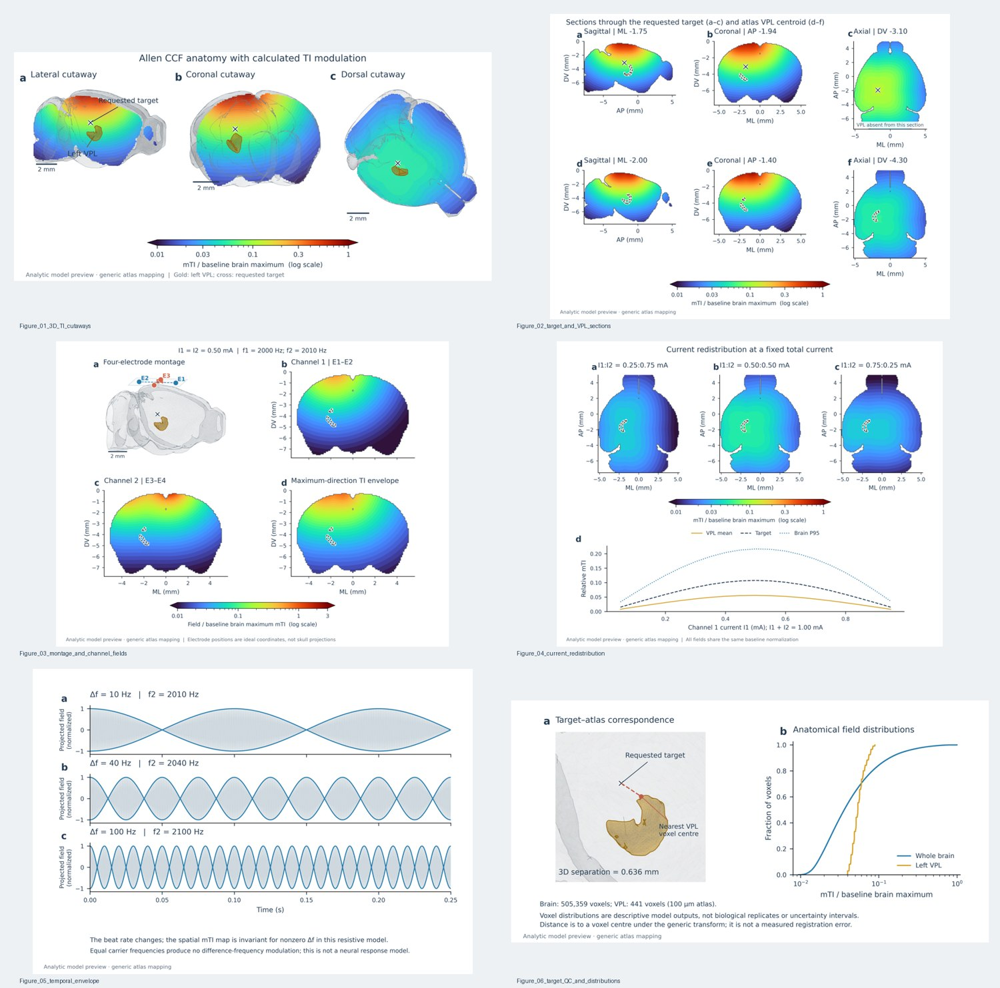

# Xu lab | VPL temporal-interference figure package

Six reproducible scientific figures, generated from the v4 analytic field equations and the bundled Allen CCF anatomy. The visual reference supplied by the user informed the transparent-brain presentation; none of its pixels or numerical values was reused.

**Scientific status: analytic model visualization, not registered multi-tissue FEM.** The default montage does not produce a whole-brain maximum inside the atlas VPL. These figures must not be presented as evidence of validated VPL-selective stimulation or neuronal activation.



## Contents

| Figure | Contents |
| --- | --- |
| 01 | Transparent brain and calculated TI field in lateral, coronal and dorsal cutaways |
| 02 | Orthogonal sections through the requested target and through the atlas VPL centroid |
| 03 | Four-electrode montage, channel 1 field, channel 2 field and maximum-direction TI modulation |
| 04 | Current redistribution with fixed I1 + I2 = 1 mA and descriptive ROI summaries |
| 05 | Projected carrier signals and analytic temporal envelopes at 10, 40 and 100 Hz frequency differences |
| 06 | Requested target versus atlas VPL and within-model voxel distributions |

The complete download package contains 600-dpi PNG, vector PDF and editable-text SVG for each figure, three transparent PNG artwork panels, English legends, methods, numerical arrays and reproduction scripts. The GitHub folder contains the reproducible scripts, documentation, numerical summary and lightweight figure previews; full-resolution files are generated locally with the command below.

## Reproduce locally

From the repository root, with Python 3.11 recommended:

```bash
python -m venv .venv-figures
source .venv-figures/bin/activate
python -m pip install -r paper_figures/requirements.txt
python paper_figures/source/render_figures.py
python -m unittest discover -s paper_figures/source -p 'test_*.py' -v
```

Windows users can run these commands in WSL. An OpenGL display, GPU, AllenSDK or VTK is not required for the six vector figures. Output is written under `paper_figures/figures`, `paper_figures/artwork` and `paper_figures/data`. Re-render only one figure with `--only 4`, for example. Source code assumes the existing `assets/allen_ccf_100um_web.json` and `ti_vpl/` package at the repository root.

## Fixed definitions

- Stereotaxic axes: AP anterior-positive, ML right-positive and DV dorsal-positive, in mm.
- Requested target: (-1.94, -1.75, -3.10) mm. It is not moved to the VPL.
- E1=(+0.14, -1.75, +0.50); E2=(-4.02, -1.75, +0.50); E3=(-1.94, +0.33, +0.50); E4=(-1.94, -3.83, +0.50) mm.
- Baseline currents: I1=I2=0.50 mA. Frequencies: 2000 and 2010 Hz.
- Display/anatomy: Allen CCFv3 2017, 100 µm; left VPL structure 718. The anatomy restricts display and statistics; it does not define a multi-tissue conduction problem.
- Absolute source values retain v4's conductivity 0.275 S/m and empirical scalar gain 0.028. This gain is not a measured or validated skull-transfer model.
- All spatial figures share one denominator: the baseline whole-brain maximum mTI, approximately 3.079379 preview V/m. Maps use a labelled logarithmic colour scale. Colour-bar extensions indicate values outside the displayed range. No panel is independently normalized.
- The maximum-direction modulation depth is an orientation-wise upper bound. It is not neuronal activation probability, stimulation selectivity or safety evidence.

## What the present model actually predicts

The mean left VPL value is approximately 0.172399 preview V/m, the requested-point value is 0.331617 preview V/m, and the whole-brain maximum is superficial at (-2.90, -0.80, -0.20) mm. The ratio of VPL median to whole-brain 95th percentile is approximately 0.248552. Absolute values inherit the uncalibrated scalar gain and are retained for reproduction, not validated exposure claims.

The requested point is 0.635689 mm from the closest left VPL **voxel centre** under this generic transform. That quantity is neither a measured registration residual nor the exact distance to the continuous VPL surface.

## Before using as formal simulation results

Use the labels and captions supplied here for a declared analytic illustration. To replace this with quantitative FEM results, obtain actual registered two-channel vector fields, verify the atlas array axis order and unilateral VPL ROI, use measured electrode contact geometry and a justified conductivity model, and report registration accuracy, mesh convergence, solver residual and current balance. The previous FEM scripts are not executed or certified by this figure package.

See [METHODS.md](METHODS.md), [FIGURE_LEGENDS.md](FIGURE_LEGENDS.md) and [中文说明](README_CN.md). Figure typography and spacing follow a restrained journal style; this is not a claim of journal acceptance or compliance with a specific journal's current submission checklist.

## Provenance and references

Baseline repository commit: `e48d25098063be8a2a2491dd6d0d24856b2b6cae`.

- Grossman, N. et al. Noninvasive Deep Brain Stimulation via Temporally Interfering Electric Fields. *Cell* **169**, 1029–1041.e16 (2017). [Article](https://pmc.ncbi.nlm.nih.gov/articles/PMC5520675/).
- Wang, Q. et al. The Allen Mouse Brain Common Coordinate Framework: A 3D Reference Atlas. *Cell* **181**, 936–953.e20 (2020). [Article record](https://pubmed.ncbi.nlm.nih.gov/32386544/).
- Sanchez-Romero, R., Akyuz, S. & Krekelberg, B. EFMouse: A toolbox to model stimulation-induced electric fields in the mouse brain. *PLOS Computational Biology* **21**, e1013471 (2025). [EFMouse repository and citation](https://github.com/klabhub/EFMouse). EFMouse is a route to subsequent multi-tissue work; no EFMouse result is claimed in the present figures.
